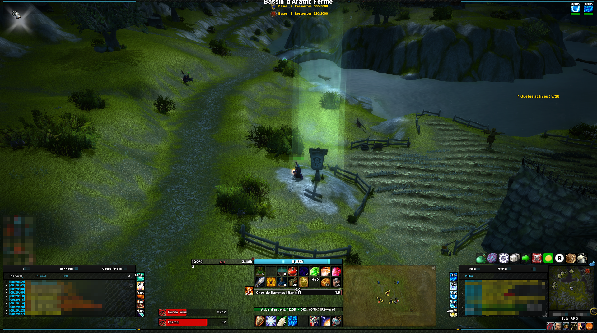
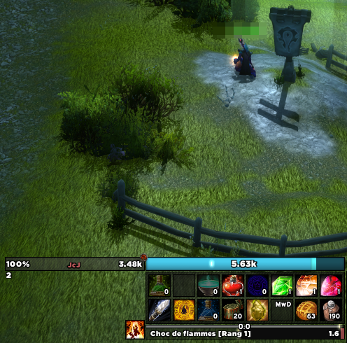

# ElvUI_SpellRanks

A simple ElvUI plugin that adds spell ranks to the cast bar in Classic Era and
Burning Crusade Classic. WoW Forever builds are experimental and require an
ElvUI version compatible with that client.

Download [Curse page](https://www.curseforge.com/wow/addons/elvui-spellranks)

See [MAINTENANCE.md](./MAINTENANCE.md) for development setup, supported-client testing, release steps, and the current maintenance backlog.

## Screenshots

